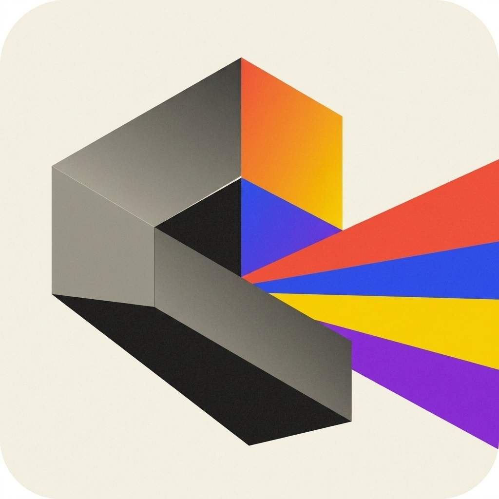
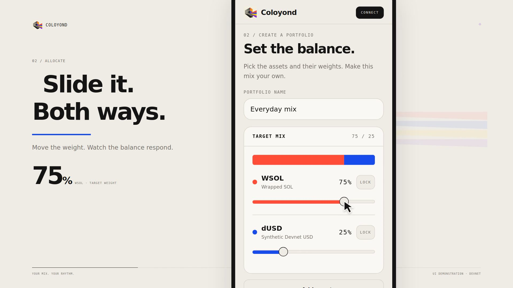
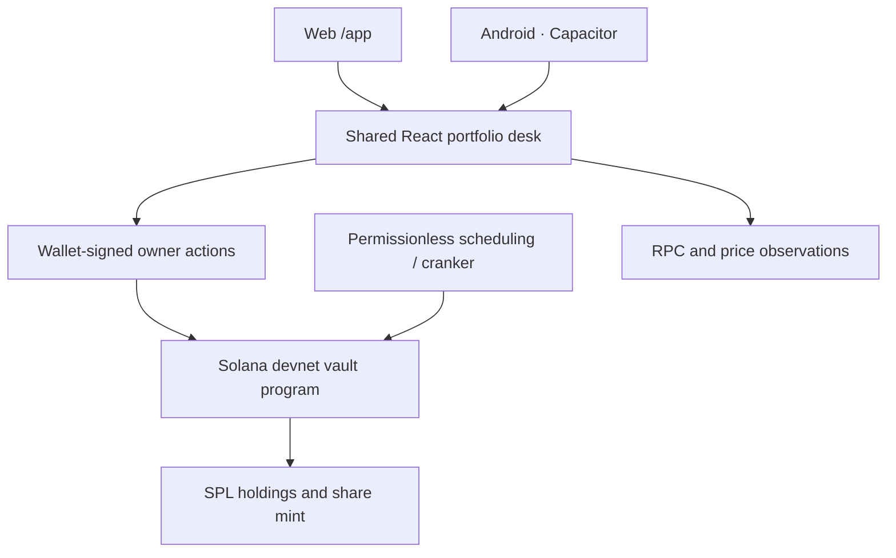

<p align="center">
  
</p>

<h1 align="center">Coloyond</h1>

<p align="center"><strong>Your assets. Your balance. Your next move.</strong></p>
<p align="center">A mobile portfolio desk for Solana.<br/>Choose a token mix, set its target weights, and manage your devnet vault from the web or Android.</p>

<p align="center">
  
  
  
  
</p>

<p align="center">
  <a href="https://github.com/a144z/coloyond/raw/refs/heads/main/releases/coloyond-android-debug.apk"><strong>Install Android APK</strong></a> ·
  <a href="https://github.com/a144z/coloyond/raw/refs/heads/main/releases/coloyond-mobile-showcase.mp4"><strong>Watch the promotion</strong></a> ·
  <a href="#run-it-locally"><strong>Run locally</strong></a> ·
  <a href="docs/mobile/verification.md"><strong>Build evidence</strong></a>
</p>

---

## A portfolio should feel like a composition

Portfolio tools often scatter allocation, custody, automation, and wallet actions across different screens. Coloyond brings those decisions into one compact desk: a visible mix, precise controls, and a clear view of the assets underneath.

The interface turns allocation into something you can work with directly. Move a slider. Pin a weight. Explore an asset. Inspect the vault. Keep the controls close to the information they change.

**Built for the Solana mobile hackathon:** a focused, installable product with one shared interface across the browser and Android, documented transaction boundaries, and a reproducible promotional film.

## See Coloyond in motion

<p align="center">
  <a href="https://github.com/a144z/coloyond/raw/refs/heads/main/releases/coloyond-mobile-showcase.mp4">
    
  </a>
</p>

<p align="center"><a href="https://github.com/a144z/coloyond/raw/refs/heads/main/releases/coloyond-mobile-showcase.mp4"><strong>Watch the 62-second promotion →</strong></a><br/><sub>1080p · Component close-ups and visible UI gestures · Uploaded stereo music with frequency-based timing</sub></p>

The film uses the actual mobile UI. Portfolio balances in presentation scenes are clearly labeled **illustrative devnet data**.

## The product

| Experience | What you can do |
| --- | --- |
| **Compose** | Name a portfolio, choose supported assets, and configure allocation, delay, and deviation threshold. |
| **Adjust** | Use sliders or exact percentages; lock a target while the other weights move. |
| **Inspect** | Review target versus actual allocation, holdings, SPL share balances, and task status. |
| **Manage** | Open deposit, proportional redemption, weight editing, and pause/resume workflows. Owner actions require signing. |
| **Connect** | Use a compatible Solana wallet; the devnet device-wallet flow is also available. |
| **Understand** | View RPC connectivity, price observations, market inventory, and local activity. |
| **Take it with you** | Run the same `/app` interface in a Gradle-built Capacitor Android package. |

### A short demo journey

1. Open `/app` and explore the portfolio desk.
2. Connect a devnet wallet, or create a devnet-only device wallet.
3. Choose assets, set weights, and lock a target to demonstrate the allocation editor.
4. Review setup before signing. A funded, correctly configured devnet environment is required for transactions.
5. Open a vault to inspect holdings and its task controls; use **System** to explain the data behind the interface.

## How it fits together



The app refreshes what it displays. Independent scheduling requires a running execution service and a correctly configured deployment. Opening the interface does not itself prove that a rebalance ran.

The mobile transaction client is in [`src/ui/app/lib/solana`](src/ui/app/lib/solana); the matching execution program source is in [`coloyond-beta/programs/coloyond-execution`](coloyond-beta/programs/coloyond-execution). The repository also retains ETF, auction, and earlier native exploration code as distinct development surfaces.

## Run it locally

**Web:** Node.js 22.12+ and npm. Node.js 24 is used by the current build environment.

```sh
git clone https://github.com/a144z/coloyond.git
cd coloyond
npm ci
npm run dev
```

Open **http://localhost:5173/app** for the mobile desk. The repository also serves the concept landing page at `/` and separate research/prototype routes.

```sh
npm run typecheck
npm run build
npx playwright install chromium
npm run test:mobile
```

`test:mobile` starts Vite and checks navigation, weight locks, key sheets, and phone/desktop widths. To use an existing Chrome installation, set `CHROME_PATH` to its executable.

### Android

Install **JDK 21**, Android SDK Platform **37.0**, and Build Tools **36.0.0**. Set `JAVA_HOME` and `ANDROID_HOME`, then:

```sh
npm ci
npm run android:apk
```

Output: `apps/android/app/build/outputs/apk/debug/app-debug.apk`.

```sh
adb install -r apps/android/app/build/outputs/apk/debug/app-debug.apk
adb shell am start -n com.coloyond/.MainActivity
```

The downloadable package is a signed **debug APK** for Android 8/API 26 and newer. Private release signing is required for store distribution. See the [Android build guide](apps/android/README.md).

### Promotional video

```sh
npm run video:studio
npm run video:render
```

The film uses the uploaded stereo soundtrack, with spectral analysis driving its beat grid and subtle frequency response. It animates real component values, cursor gestures, sheets and navigation in a deterministic UI presentation. See the [Remotion guide](remotion/README.md) for the storyboard, research, audio analysis and reproduction steps.

## Built, checked, and explicit about scope

| Area | Evidence |
| --- | --- |
| Web build and TypeScript | Verified build and type checks. |
| Mobile interface | Browser checks for navigation, weight locks, sheets, and widths from 320px to 1440px. |
| Android package | Gradle assembly, APK signature checks, and packaged `/app` inspection. |
| Promotion | Rendered video, visual framing checks, stereo audio verification, and unclipped levels. |
| Live wallet and execution | Physical-device signing and end-to-end on-chain rebalance execution still require dedicated validation. |

Coloyond is a **devnet MVP**. Synthetic test assets are not backed by redeemable dollars. The build evidence establishes UI and packaging behavior; it does not establish audited contracts, mainnet readiness, or a successful live deployment. Legacy prototype routes and the promotional footage use explicitly marked presentation data.

Read the [verification report](docs/mobile/verification.md), [mobile design](docs/mobile/design.md), and [program/execution evidence](docs/rebalancing/evidence/) for the precise boundaries.

## Repository map

| Path | Purpose |
| --- | --- |
| `src/ui/app/` | Shared mobile screens, state, controls, and Solana transaction client. |
| `apps/android/` | Gradle/Capacitor shell; previous native code is retained under legacy source folders. |
| `coloyond-beta/programs/coloyond-execution/` | Execution program matching the integrated mobile client configuration. |
| `programs/` | Additional Solana/Anchor program implementations and research surfaces. |
| `packages/` | Protocol clients and execution utilities. |
| `remotion/` | Promotion source, UI demonstration, uploaded music and spectral analysis. |
| `releases/` | Downloadable debug APK and promotional MP4. |
| `docs/` | Design, build evidence, protocol investigation, and runbooks. |
| `coloyond.jpg` | Canonical supplied project artwork. |

## Build with us

Focused contributions are welcome: clear device/wallet test reports, reproducible transaction failures, stronger deployment evidence, and improvements to accessibility or the portfolio workflow. Include reproduction steps and the relevant route or program when reporting a problem.

<p align="center"><br/><strong>Coloyond</strong><br/><sub>A mix of your own.</sub></p>
