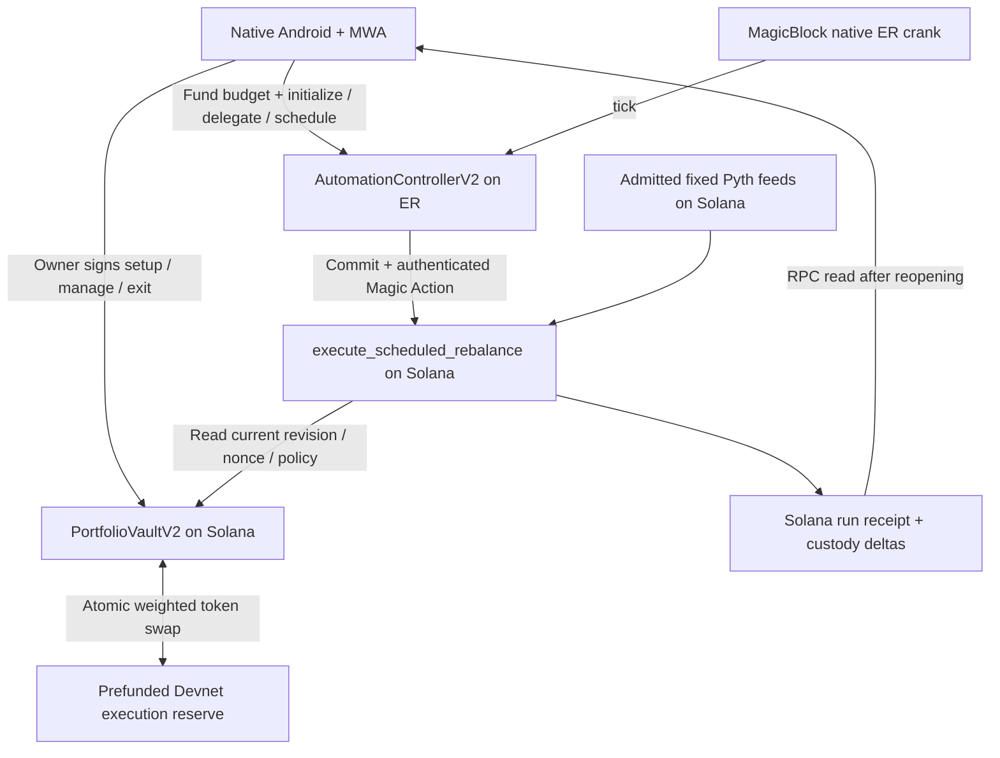

# Issue #38: design and code reduction

The [spec](../superpowers/specs/2026-10-11-issue-38-mobile-portfolio-spec.md) defines R0–R7. Recommended approach: a small personal-vault v2 program using the existing ETF math/oracle libraries, a native Compose portfolio flow using existing MWA/recovery infrastructure, and MagicBlock scheduling with Solana custody. Build the execution proof before removing old implementations. The [plan](../superpowers/plans/2026-10-11-issue-38-mobile-portfolio-plan.md) gives the overnight order.

## Audit baseline

The working checkout was `eab593e`; fetched `origin/main` was **`39957e871f8d647bdd25d01a1ebe21273d54bf6e`** on 11 October. This assessment inspected the latter through a read-only archive in `/tmp`, without replacing the working checkout. Rebase implementation onto current `main` before applying these cuts. Paths in the audit/pruning tables describe that fetched revision, not necessarily files in an older checkout.

| Observed code | What it proves / what is missing |
|---|---|
| `crates/etf-math/{value,weighted,shares,wide}.rs` and independent reference corpora | Reusable bounded integer valuation, deviation, conservative weighted quotes, and proportional accounting. They are not a complete settlement instruction. |
| `crates/etf-oracle/src/lib.rs` | Reusable fixed-feed parser/validator; source identities and live freshness still need current admission. |
| `programs/coloyond-etf/src/instructions/{risk,liquidity}.rs` | Seed and proportional custody lifecycle exist; `swap_exact_in` and `poke` still return `PolicyNotFrozen`. No automatic swap exists. |
| `programs/coloyond-etf/src/{pda,config}.rs` | V1 identity is config-hash based, targets immutable, and the mechanics profile accepts exactly 50/50 WSOL/Test USD. It cannot support separate identical personal vaults or custom weight editing unchanged. |
| `packages/keeper/src/executionLayer.ts` | Provider priority selection only; declaring MagicBlock first does not register or execute a task. Existing scheduling contract is maintenance-only. |
| `packages/etf-client/src/{wallet-submit,receipt,readback}.ts` and `src/ui/etf/IndexedDbSubmissionJournal.ts` | Valuable transaction lifecycle and verification patterns. V1 schemas and operations are not v2 builders. |
| Android `wallet/`, `core/rpc/`, `core/storage/`, `wallet/vault/VaultTransactionCoordinator.kt` | Native signing and recovery foundation. Coordinator is currently limited to v0.3.0 deposit/redeem and hard-coded protocol bindings; generalization is necessary. |
| Android `protocols/etf/ui/EtfPoolOperationsScreen.kt` | Explicitly synthetic and display-only. It is not a live ETF wallet integration. |
| `src/ui/portfolio/RebalanceDesk.tsx` and `rebalance.ts` | Useful allocation controls, locking/undo concepts; runtime swaps and prices are simulated. Do not promote simulation math into execution. |

The latest test-profile note admits bounded Devnet mechanics for a colleague deployment route. Earlier sections still use draft language; code remains partly gated. Neither document admission nor a Localnet synthetic fixture is proof of an actual deployment, successful swap, or unattended run.

## Shapes and decision

| Shape | Mechanism | Decision |
|---|---|---|
| CURRENT | Cards/Glider, public auction vault, sample rebalance desk, and ETF v1 console coexist; schedulers update eligibility and trades need an independent trader. | Baseline; does not satisfy #38. |
| A | Modify the public ETF v1 contract and native client in place; add management, transfer authority, and liquidity while retaining immutable/share/governance identity rules. | Reject for the deadline: every new management action collides with existing public-holder semantics and identity. |
| B | Add owner/nonce personal-vault v2; reuse math/oracle/wallet recovery; ER crank commits a small controller and invokes an authenticated Solana swap against a funded Devnet reserve. | Recommended, subject to F1–F3 below. |
| C | Add the same v2 vault/reserve but use a MagicBlock Hydra base-layer recurring task submitted by an independent operator. | Lower-complexity alternative if independently operated Devnet service is proven immediately. |

Hydra's official repository describes a separate cranker binary; deployment of its program does not establish independent execution coverage. Do not run our own cranker to claim the no-bot result. [Hydra source](https://github.com/magicblock-labs/hydra)

### Detail B: parts

| Part | Mechanism | Flag |
|---|---|---|
| B1 | Replace Android home with Compose vault list/create/detail/review sheets using the existing MWA sign-only gateway and durable submission coordinator. | |
| B2 | Create `PortfolioVaultV2` with owner/monotonic nonce identity, internal ownership units, immutable mints, editable target revision, and owner-only in-kind exits. | |
| B3 | Prefund separate `DemoMarketV1` SPL accounts; a shared oracle-anchored swap function enforces the weighted-curve output bound, validates both sides, and signs real two-way transfers through scoped PDAs. | |
| B4 | Delegate only `AutomationControllerV2`; a native ER crank emits a post-commit Magic Action into the L1 rebalance handler, with no owner signer at runtime. | ⚠️ F1 |
| B5 | L1 handler verifies action escrow, controller/vault binding, generation/run nonce, cadence, oracle set, drift, budgets, and atomic transfers; receipts come from L1. | |
| B6 | Choose independently refreshed fixed Pyth feeds and demonstrate repeated fresh reads over the entire unattended run. | ⚠️ F2 |
| B7 | Measure a bounded one-leg planner and action payload on the pinned SDK/SBF stack; select explicit Devnet loss/inventory bounds. | ⚠️ F3 |
| B8 | Remove competing release entrypoints first, then delete unreachable modules/dependencies with reference checks and the corresponding build gates. | |

### Fit check

This evaluates known mechanisms, not completion. A flagged mechanism is a failure until the feasibility spike supplies evidence.

| Req | Requirement | Status | CURRENT | A | B | C |
|---|---|---|---|---|---|---|
| R0 | A user completes the portfolio journey in the native Android app using a real MWA wallet on Solana Devnet. | Core goal | ❌ | ✅ | ✅ | ✅ |
| R1 | The same owner can create and fund multiple isolated vaults with custom valid weights over two or three admitted assets. | Must-have; Monday uses two assets | ❌ | ❌ | ✅ | ✅ |
| R2 | MagicBlock causes real portfolio token exchanges after setup without another owner signature, an open app, or a project-operated off-chain process during the funded automation window. | Must-have | ❌ | ❌ | ❌ | ❌ |
| R3 | The owner can edit weights and cadence, pause/resume automation, deposit, withdraw in kind, and close a vault safely. | Must-have | ❌ | ❌ | ✅ | ✅ |
| R4 | Every swap uses real funded counterparty assets, checked weighted AMM math, validated Pyth prices, a curve-fee margin, and bounded execution loss. | Must-have | ❌ | ❌ | ❌ | ❌ |
| R5 | Wrong authority/accounts, stale prices, insufficient inventory/funding, replay, and uncertain transactions cannot produce false success or unintended transfers. | Must-have | ❌ | ❌ | ✅ | ✅ |
| R6 | The product shows confirmed holdings, allocation drift, automation health, costs, and transaction evidence accurately. | Must-have | ❌ | ✅ | ✅ | ✅ |
| R7 | The implementation removes competing runtime paths while retaining reusable verified foundations and reproducible evidence. | Must-have | ❌ | ❌ | ✅ | ✅ |

Failures: B/R2 requires F1 and F2; B/R4 requires F2/F3. C additionally needs proof of an independent Hydra operator. A does not retain its original semantics while providing independent custom editable vaults. Choose B for implementation exploration, not as a claim of proven feasibility. The separate [feasibility spike](../rebalancing/spikes/issue-38-execution-feasibility.md) states the exact evidence needed.

## Execution architecture



**Custody, owner rights, target revision, replay protection, and the authoritative run receipt stay on Solana.** Only a small scheduler controller and its dedicated fee-payer path are delegated. The controller requests work; it cannot overwrite authoritative vault state. No ordinary SPL account is assumed writable inside an ER.

MagicBlock documents cranks executing in the ER. Its post-commit Magic Actions can invoke Solana handlers while the controller remains delegated. Combining these is our proposed design; the composition must be proven on the pinned Devnet stack. [Crank implementation](https://docs.magicblock.gg/pages/tools/crank/implementation), [Magic Actions overview](https://docs.magicblock.gg/pages/ephemeral-rollups-ers/magic-actions/overview)

Program-owned runtime funding/signing is a hard F1 condition. The wallet signer in tutorial examples cannot remain required for `tick` or commit/action creation. Establish that the controller's program-owned fee authority can sign through the supported CPI path, is adequately delegated, and is bound to the action escrow. If it cannot, use proven shape C or record the specific blocker; do not store a user key on a server.

Owner setup/cancellation transport, scoped sequence/idempotency and terminal recovery follow the normative spec. All owner L1 mutations consume the appropriate owner-op sequence; runtime actions do not. Weight-only edits preserve scheduling; cadence/pause/resume/close change generation. Cancellation follows L1 pause and may leave finite fee burn/refund pending.

## V2 ownership, identity, and accounts

Use a new account schema/PDA namespace and IDL. Prefer a small `programs/coloyond-portfolio` program linking the existing pure libraries over rewriting the public v1 program. Share helpers where their semantics match; never deserialize v1 bytes as v2.

| Account | Identity / purpose |
|---|---|
| `OwnerRegistryV2` | PDA `['portfolio_owner_v2', owner]`; monotonically increasing `next_vault_nonce`, bounded pages of active vault IDs, and closed-ID tombstones. Owner pays rent. |
| `PortfolioVaultV2` | PDA `['portfolio_vault_v2', owner, nonce_le_u64]`; owner, nonce, lifecycle, ordered admitted assets, targets, policy hash, config revision, owner-op sequence/last operation ID, automation generation/enabled, units, last run/next allowed time, loss budget, last confirmed outcomes. |
| `VaultAuthorityV2` | PDA `['portfolio_authority_v2', vault]`; authority for only this vault's classic SPL custody. |
| `CustodyV2[i]` | PDA `['portfolio_custody_v2', vault, asset_index]`; exact mint/program constraints. Funding and redemption use owner ATAs. |
| `AutomationControllerV2` | PDA `['portfolio_controller_v2', vault, generation_le_u64]`; immutable vault/generation binding, admitted payload hash, interval, tick nonce, task identity. Delegate this account, not the vault. |
| Automation fee authority/balance | Vault/generation scoped program PDA and supported MagicBlock fee/escrow accounts. No shared unlimited payer and no token-custody spending. Exact derivation fixed by F1. |
| `DemoMarketV1` | Separate policy-bound market state, funding authority, inventory accounts, rate/run caps, reserve loss budget, and allowed mint set. No permission to manage user vaults. |

Registry pages avoid an unbounded growing account. Monday can impose a clearly displayed maximum of four active vaults per owner; the complete prototype supports additional pages. No identity is derived from target weights alone. Two identical portfolios therefore have different vaults. `portfolio2:<genesis>:<program>:<vault>` is stable; the configuration hash/revision is separate.

No SPL ownership share mint is created in v2. Internal `u64` ownership units let proportional deposit/redeem reuse existing math without transferable third-party claims. Only the vault owner can add or redeem units. Full exit returns every token base unit exactly; a new deposit after full exit requires a new nonce. Public LP governance, delayed role handoffs, and transferable shares belong to v1 and are not relaxed in place.

## Instruction surface

| Instruction | Signer / effect |
|---|---|
| `create_vault` | Owner signer; validates admitted basket/targets and expected registry nonce/owner-op sequence, creates empty paused v2 custody, increments nonce atomically. |
| `fund_vault` | Owner signer; first funding values a valid basket and issues internal units; later funding requests target units and directly transfers live-proportional inputs within reviewed maxima; unused maxima remain in the wallet. |
| `update_allocation` | Owner signer + expected revision; validates new weights, increments revision/epoch only, preserves task/escrow generation and budget, resets hysteresis, starts 120-second cooldown. No asset-set changes. |
| `configure_automation` | Owner signer; confirms cadence/budget caps and a new controller/generation. Initialization/delegation/task registration may require separate transactions. |
| `activate_automation` | Owner signer; verifies latest controller/task registration evidence required by the pinned adapter; enables only that generation after setup. |
| `tick` | ER scheduled execution; increments controller run nonce and requests fixed-program post-commit work using program-controlled runtime payer/signing. |
| `execute_scheduled_rebalance` | Authenticated Magic Action; shared bounded swap handler. No owner signature. |
| `rebalance_once` | Owner signer; separate thin diagnostic entrypoint calling the same swap function. A manual call never counts as unattended evidence. |
| `pause_automation` | Owner signer on L1; disables and increments generation immediately. Provider cancellation follows; exits do not wait. |
| `withdraw_in_kind` | Owner signer; pro-rata or full custody return with minima, independent of oracle/provider. Full exit invalidates automation. |
| `close_vault` | Owner signer; no active units; sweep donations to owner, close empty custody and eligible state, retain registry tombstone. Scheduler refund/cleanup status is explicit. |

Names are the proposed ABI, not currently generated instructions. Cadence changes follow configure/activate for a new generation. Avoid one giant setup transaction: measure serialized bytes/account/CU limits and expose resumable owner actions.

## Counterparty and bounded planner

The reserve is a real, separately funded on-chain counterparty. If the vault is SOL-heavy, choose underweight token `i` as reserve input and overweight SOL `j` as vault output. Actual output is oracle-anchored with explicit reserve compensation, capped by the weighted curve; taking the full curve quote after an edit would expose the owner to unnecessary arbitrage loss:

```text
curve_bound = etf_math::quote_exact_in(vault_reserves, targets, i, j, gross_input, 30_bps)
oracle_output = ceil(conservative_input_value * 1.003 / price_j_lower)
require(0 < oracle_output <= curve_bound.amount_out)
reserve[i] -= gross_input; vault[i] += gross_input
vault[j] -= oracle_output; reserve[j] += oracle_output
vault.fee_counter[i] += curve_bound.fee_amount  // informational, already in custody
```

Use checked classic SPL `transfer_checked` CPIs with the reserve authority and vault authority PDAs. Re-read post-CPI account amounts and reconcile exact deltas. No minting during a rebalance, balance overwrite, fabricated quote, automatic liquidity refill, or same-vault transfer masquerading as a swap is allowed. Reserve funding is a one-time reviewed setup plus explicit replenishment when inventory/budget runs out.

For Monday, select the largest normalized shortfall/overage pair with deterministic mint-index tie breaking. Candidates are `floor(min(all_input_caps, to_target_input) / 2^k)` for `k = 0..3`, excluding zero/duplicates. Cap the first input by underweight value needed, inventory, NAV, input custody ratio and output bounds. Require rounded post-trade input weight <= its target and output weight >= its target; neither crosses the target. Choose the safe candidate with greatest `D_pre - D_post`, tie break by smaller input. No safe candidate means a recorded no-op. This is a bounded heuristic, not global optimality or guaranteed convergence for every portfolio.

Every accepted candidate must have nonzero output, preserve the weighted curve within the math's proven domain, strictly reduce the same-price `D`, stay within custody/size limits, and respect both sides' value-loss budgets. Aggregate loss is measured from pre/post oracle NAV under the same observations; fees are already included in reserves. Accumulate positive losses in absolute fixed USD units against an owner-approved budget; do not reset this budget automatically on each tick or weight edit. Mark-to-market movement between ticks is reported separately.

Require `value(j received by reserve, price_j_lower) >= value(i paid by reserve, price_i_upper) * 10,030 / 10,000`. It does not subsidize vault fees. Allow only manifest-admitted demo owners and enforce market-wide, owner-wide and per-vault fixed USD notional budgets; new vaults, edits and close/reopen cannot reset owner/global budgets. Its manifest-pinned administrator can manage reserve inventory/admission but has no vault custody/target authority. Shared inventory means availability is not isolated even though vault custody is. Include 120-second edit cooldown and finite remaining capacity in review.

**Do not carry v1's symmetric near-parity quote band or full curve-output rule into v2.** Actual output is the conservative oracle quote with reserve spread; the fee-adjusted curve is an upper bound. F3 must prove compatibility with loss/invariant/direction bounds and convergence before the automatic path is enabled. If the tests cannot pass, report No safe trade rather than silently widen the policy.

### Policy choices

| Field | Proposed initial choice / readiness |
|---|---|
| Asset count / weights | Monday two; complete prototype two or three. Targets total 10,000 bps, floor 100 bps. Match existing pure math domain. |
| Valuation | Existing integer `10^-12 USD` normalization; mint decimals <= 9 and approved exponent domain. |
| Fees | Fixed 30-bps curve-input fee margin plus separately disclosed 30-bps reserve spread in actual oracle output. Reserve receives conservative value plus spread; no subsidy. |
| Oracle age / confidence / skew | 60 s / 100 bps / 30 s maximum inter-feed publish skew; F2 must prove suitability, never relax solely to fit stale feeds. |
| Trigger / stop / cadence / edit cooldown | Start 200 bps, stop 50 bps, 60-second accepted-evaluation floor/75-second scheduled interval, 120-second post-edit cooldown; F1/F3 must validate actual execution/convergence. |
| Per-cycle work | One leg, at most four weighted quotes; integrated CU/payload measurement required. Existing isolated quote evidence is roughly 28k CU per quote, not an integrated budget. |
| Size / loss / notional bounds | Input <=100 bps NAV and <=1,000 bps input custody; output <=1,000 bps output custody. Loss <=25 bps pre-trade NAV/leg; cumulative owner-approved fixed loss allowance initially 100 bps seed NAV. Per-vault input notional <=seed NAV and smaller owner/global remaining allowance. No reset or zero-as-unlimited. |
| Automation duration/funding | Based on observed fees/run and confirmed funding. Do not advertise an indefinite zero-cost task. |

The numeric candidates above are implementation starting points, not production policy. Freeze exact values in one `portfolio-devnet-v2` manifest with source/artifact hashes; Kotlin, Rust, TS, and UI must read the same version.

Initial funding uses reviewed exact inputs and a pinned initial-unit rule. Subsequent deposits request target units with per-token maxima; partial withdrawals burn units with per-token minima computed against live custody. The coordinator reconciles actual in-bound amounts, units and operation ID/sequence, because automation can race review. Atomic bound failure is not a partial success.

## Authentication, consistency, and shutdown

The action handler must require the Delegation Program-derived escrow **signer**, exact escrow authority bound to this vault/generation's program-owned payer, and the pinned escrow index. `#[action]`, a PDA address, or account ownership alone does not authenticate the caller. Use separate action and owner-only manual entrypoints over one internal function. [Magic Actions authentication guidance](https://docs.magicblock.gg/pages/ephemeral-rollups-ers/magic-actions/troubleshooting)

Validate the committed controller's exact key/discriminator, its permitted delegation owner, vault/generation/payload binding, and run nonce. The writable L1 vault holds authoritative `last_consumed_run_nonce` and cadence. A valid action must match the currently enabled generation and a newer nonce; consume each nonce only once. A replay/stale task is an idempotent no-transfer result; old-generation callbacks never write latest-attempt status, with no change to the last trade time. Multiple scheduled copies cannot bypass the on-chain time or loss cap.

Read live vault revision/targets/prices at execution time. Do not trust stale ER copies of the portfolio or swap amounts. Weight edits read through to the next eligible action using current L1 revision after cooldown; they do not require re-registration. Pause/cadence replacement invalidates the generation before ER cancellation; old tasks cannot trade and can spend only their finite remaining fee budget until cancelled. L1 account locks serialize rebalance against deposits/withdrawals; if a valid rebalance lands first, the subsequent owner review must reconcile the changed state. If pause lands first, later old tasks cannot trade.

Early/cooldown attempts do not change nonce/timer/state. Eligible economic blocks (stale valid feed, low inventory, paused/generation mismatch) produce explicit no-transfer receipt outcomes where safe, so a failed trade does not become infinite unsafe retries. Malformed accounts/forged authorization/failed CPIs fail atomically. The exact provider retry/commit rollback behavior is F1 evidence, not inferred from events.

Shutdown returns tokens without the ER. Fee refunds and controller cancellation may need the ER/provider; track them separately. Preserve the monotonic registry/tombstone and never re-create an old vault address. An old callback to a closed/missing account cannot initialize custody. Close controller/fee accounts only after supported cancellation/readback; missing rent refunds remain Pending cleanup.

Receipts/events distinguish manual versus Magic Action trigger and record the executed L1 revision. Only action-sourced swaps satisfy unattended/convergence evidence. Test USD uses the independently updated USDC/USD Pyth feed as a quote convention, with the same age/confidence/skew checks; it is synthetic and unbacked. A 27-cycle hosted run through commits 26/27 is Required by the spec, beginning by 03:00 and observed by 03:45.

Freeze program/IDL/manifest hashes before 03:00 evidence. Use an untouched dedicated observed vault; generation tests use other vaults outside the stopped-app window. Funding budgets cover diagnostics, observation and rehearsal plus 50% headroom under fixed caps. Owner setup never delegates the owner system account; a supported L1-funded program-owned ephemeral balance is the only alternate setup payer.

## Native app design and wiring

One Portfolio destination replaces Cards/Portfolio/Wallet chips for the issue #38 build. Connect/status controls live in its header. A list, create sheet, vault details, allocation editor, and common review sheet are enough. Raw feeds/program IDs are expandable diagnostics, not the default home content.

| UI affordance | Reads / writes | Wires out |
|---|---|---|
| U1 Connect wallet | MWA account + network | N1 → N2 |
| U2 Vault list / Refresh | Owner registry and verified vault snapshots | N2; open U4 |
| U3 Create portfolio sheet | Admitted assets, exact weights, amounts, cadence/budget draft | N3 → U7 |
| U4 Vault details | Holdings, target/current bars, status, last check/trade, budget | N2; U5/U6/U7 |
| U5 Allocation editor | Integer bps draft; optional lock/undo; same basket only | N3 → U7 |
| U6 Manage actions | Add funds, Pause/Resume, Withdraw, Close | N3 → U7 |
| U7 Common transaction review | Exact network/program/accounts/revision, amounts/costs | N4 → N1 → N5 |
| U8 Pending/recovery banner | Durable operation phase and reconciled receipt | N5; disable new wallet handoff while unknown |
| U9 Automation activity | L1 trade/no-op receipt, ER status separately, explorer link | N2/N6 |

| Non-UI affordance | Mechanism |
|---|---|
| N1 Wallet gateway | Existing `MwaWalletGateway` sign-only flow; validate returned signer/account and message bytes. |
| N2 Portfolio repository | Pinned-genesis RPC + v2 decoder/manifest; registry discovery; immutable typed snapshots; raw balances available without prices. |
| N3 V2 instruction builder | Small Kotlin serializers/PDA helpers from generated v2 IDL with shared Rust/TS/Kotlin golden vectors. No v0.3.0 discriminators reused. |
| N4 Operation coordinator | Extract protocol-neutral message/review/persistence/submission/reconciliation core from `VaultTransactionCoordinator`; remove hard-coded vault/program/pending-kind assumptions by typed operation binding. |
| N5 Durable journal | Existing `PendingActionRecord`/store extended with v2 identity/revision/generation and effect expectations; preserve uncertain states across process death. |
| N6 Automation adapter | Explicit base/ER connections, resumable registration/delegation/funding/cancel; no Android service or embedded private key. |

Monday's candidates are physical Solflare/Phantom Devnet with observed MWA L1 and ER-blockhash sign-only support. Owner ER registration/cancel/refund uses reviewed ER transport and owner setup payer; runtime uses the program PDA. Both failing means read-only partial delivery; L1-only support permits partial custody/exit with automation unavailable. One reviewed transaction per handoff, confirmed in order; an unsupported sign-only wallet cannot silently use sign-and-send. Journal intent/blockhash/expiry/effects before handoff and validated signed bytes/signature before app broadcast. Use the spec's owner-op sequence/unique operation ID per registry/create or vault mutation. Sign-only interruption before durable bytes/no app broadcast is Not submitted; finalized expiry plus unchanged sequence/absent operation and finalized history readback is Expired. Unknown blocks only conflicting scope handoffs; ER cleanup cannot block L1 withdrawal. Never auto-resend. Finite resolution depends on chain progress/finalized RPC, not provider cancellation.

Prefer legacy messages for the bounded two-token flow if limits permit. Derive all addresses, precreate required ATAs, and validate writable/signing accounts. If setup requires v0 messages, verify MWA and decoder compatibility first. Owner action replies cannot silently change payer or program. Withdraw WSOL as SPL tokens; automatic unwrap and owner-key recovery are deferred. Keep internal ownership units to reuse proven proportional math, without a public share mint.

### Screen composition

- **List:** app name, Devnet, wallet account; Create portfolio; vault name + asset mix + written status + last trade. Local names are annotations to verified vault IDs.
- **Create:** asset rows, decimal weight fields, total, funding quantities, cadence and separate automation budget. Review button remains disabled until the full draft is valid.
- **Details:** name/mix; actual-versus-target bars and table; Rebalancing/Within tolerance/Blocked state with reason; last check and last trade as separate facts; Add funds / Edit / Withdraw; Pause and Close in management area.
- **Review:** owner account and Devnet; exact assets/quantities; changes; automation authority limits/costs; Approve in wallet. Dismissing the sheet before handoff sends nothing.
- **Cleanup:** Assets returned is distinct from All accounts closed. Display reclaimable/refunded budget separately.

The [standalone mobile design preview](issue-38-mobile-portfolio.html) illustrates list/create/detail/blocked states. It never connects a wallet or pretends to execute on-chain.

## Code cuts

Do not begin with mass deletion. First isolate the issue #38 app route/build graph, prove B4/F2/F3, then remove code that is unreachable and has no remaining importer or required test/evidence role. Preserve historical source in Git; avoid moving entire superseded programs into a new active archive folder.

| Area at audited main | Action | Reason / boundary |
|---|---|---|
| Android `core/rpc`, `core/storage`, `wallet`, theme, manifest, Gradle | Keep and adapt | Already supports native wallet transport/recovery. Pin toolchain. |
| Android `wallet/vault/VaultTransactionCoordinator.kt` | Extract shared core | Reuse validation/journal/reconciliation; replace protocol-specific assumptions through typed bindings. |
| Android `protocols/coloyond/transactions` readers | Extract generic message/SPL decoder helpers | Do not reuse v0.3.0 ABI or program constants. |
| Android `protocols/etf/ui` and presentation | Replace synthetic operations surface | Use real v2 repository and owner actions; keep useful fact/status formatting. |
| Android card/generation/import/Glider/Symmetry routes | Detach from issue #38 home/build path first; delete only after new native route works | They do not prove this portfolio. Avoid collateral manifest/provider removals until reference checks. |
| `crates/etf-math`, oracle, reference tests/vectors | Keep | Highest-value reusable correctness work. Pruning tests to make settlement changes pass is forbidden. |
| `crates/etf-identity` | Keep v1 as historical compatibility; add distinct v2 scheme | Stable owner/nonce identity cannot reuse immutable config-hash pool identity. |
| `programs/coloyond-vault` auction/conditions/governance/bounty | Remove from issue #38 Anchor/Cargo build targets, then retire source after rollback baseline | Own keeper/solver architecture and public liabilities conflict with deadline shape. |
| `programs/coloyond-etf` public v1 | Keep until helpers extracted and tests compared; then remove from active release build | New personal v2 must not weaken existing public-holder semantics in place. |
| `packages/keeper` / Node condition loops | Remove from issue #38 runtime | A project-operated loop cannot be the automation dependency. Keep useful network-identity checks only. |
| `packages/etf-client` journal/receipt/math patterns | Keep/adapt for v2 development tools | Avoid a second production web interface. V1 read model remains versioned. |
| Web `RebalanceDesk` allocation controls | Port concepts to Compose or extract pure integer allocation helpers | Remove sample dollar balances, `reweigh`, random market moves, timer-driven simulated execution, 70/30 payout. |
| Web Shield/Yield/Game/Ecosystem, LI.FI/deBridge router/executor/token map | Remove from release navigation; then remove modules/dependencies if no tool uses them | Cross-chain paths and engagement distract from Solana mobile custody/automation. |
| Web auction/condition/Symmetry labs | Developer/historical surfaces only; detach release entrypoints | They are different programs and cannot masquerade as v2. |
| `tools/etf-localnet`, relevant math/oracle probes, deployment facts | Keep/adapt | Retain failure, custody and source/IDL evidence. |
| Old synthetic demo data / published manifests / IDLs | Version and separate; never rename to v2 | No fixture/placeholder can pass as a deployed portfolio. |
| README/HANDOFF and competing normative docs | Add a clear issue #38 direction link; mark old release scope historical for this task | One current entrypoint, with audit history retained. |

This is a staged prune plan, not a deletion performed by the design task. Monday's cut only detaches competing release navigation/imports. Physical source deletion, dependency removal and workspace retirement follow after Monday, once the native demo is stable and reference checks pass.

## Manifest and unresolved proof

The manifest pins genesis, program/ProgramData and upgrade authority, binary/IDL/source hashes, v2 schema/policy, exact assets/decimals/authorities, feed owner/layout/ID/key, reserve identity/inventory caps, MagicBlock programs/validator/SDK versions, task payload/escrow derivations, fees, and an observation window. Publish only public values. Kotlin and TS validate it before building a wallet review.

Fresh fixed feed support and provider-driven action signing/cancellation are externally dependent. The oracle integration guide describes fixed feed accounts continuously updated by an independent process; their existence alone does not ensure freshness. A pull update fetched by the client is insufficient once the app stops. [Pyth Solana guide](https://docs.pyth.network/price-feeds/core/use-real-time-data/pull-integration/solana)

MagicBlock's current fee documentation includes commit limits and live funding requirements. Test past the no-fee-payer commit ceiling, include action/commit/delegation/refund costs, and observe underfunding behavior. The blueprint's earlier zero-fee/session pricing is not the budget model. [Fees, commits, and refunds](https://docs.magicblock.gg/pages/ephemeral-rollups-ers/introduction/fees-and-commit-economics)

Do not complete an issue by describing an assumed service. F1–F3 remain unproven in this design task; the first implementation slice must resolve them. If they fail, preserve working mobile custody/exit and identify exactly which autonomous claim cannot be demonstrated by Monday.
