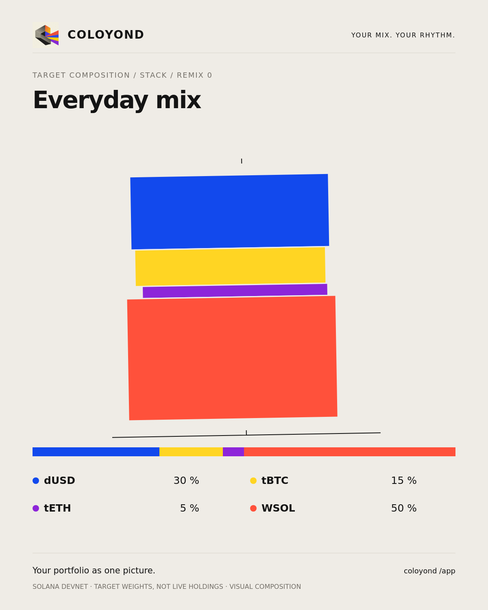

# Your portfolio as one picture

Coloyond renders a shareable, visual portfolio composition locally in `/app`. Each saved vault and draft has artwork derived from its target allocation. Cards are **1200 × 1500 PNGs** with the project icon, portfolio name, asset colors, exact normalized targets, and a clear Solana devnet / target-weights label.

## Use it

1. Choose assets and weights in Create, or open an existing portfolio.
2. Tap **Share portfolio card** to see the exact card preview.
3. **Remix artwork** changes the composition without changing your vault's targets.
4. **Share PNG** sends the generated file to supported mobile web share sheets. **Download PNG** saves it in other browsers. Android uses a cache-scoped native share sheet, where you can choose an installed app or a save destination.
5. **Copy remix link** creates a web URL containing only the portfolio name and target weights. Opening it prefills an unsigned draft; recipients can adjust it and must connect/sign with their own wallet to create a vault.

The app does not publish automatically, submit transactions when exporting, expose wallet addresses/balances in cards, or promise viral reach. It provides the artwork and portable sharing/remix controls for community use.

## Geometry and reproducibility

`src/ui/app/lib/art/portfolio-card.ts` is shared with Remotion. A canonical, asset-ID-sorted allocation is normalized to 100%. Portfolio ID, normalized weights and remix number seed a deterministic FNV hash. The seed selects **Orbit**, **Prism** or **Stack** geometry and varies the angle, radius or offsets. Target weights determine sector angles or band heights, while each token keeps its established color.

The same input produces the same SVG; distinct vault identities and allocations produce distinct compositions. Remix changes only the seed input. The preview and PNG use the same self-contained SVG, including the supplied project artwork embedded from `public/coloyond-icon.png`. Rendering uses the browser canvas and has no paid service, network image request or server render dependency. Token legends show the exact normalized percentages, including fractional weights.

The URL parser accepts only supported asset IDs, finite percentages in 0–100, and bounded names/payloads. It rejects invalid/empty mixes, escapes SVG text, and never imports addresses or executes wallet actions. Remix URLs carry targets, not holdings or custody claims.

## Android

Capacitor Filesystem writes the generated PNG to the app's cache. Capacitor Share hands the URI to Android's chooser; it does not request broad external-storage access. The PNG is ready before export begins. The web fallback remains available independently of native plugins.

If Android should also copy public web remix links, build with `VITE_COLOYOND_PUBLIC_URL=https://your-deployed-host.example` set to the actual deployed `/app` origin. Without a configured public host, Android still shares PNGs and directs remix-link users to the web app; it never sends an unusable `https://localhost` URL. Browser remix links use the current origin. No production hostname is invented by this repository.

## Verification

`npm run test:mobile` exercises production SVG-to-canvas PNG rendering and checks the PNG signature and 1200×1500 dimensions. It checks stable output, changes for different vaults/weights/remixes, escaped names, address/balance omission, a single-asset edge case, actual browser download, a mocked Web Share file handoff, invalid-link rejection, and a new-tab remix URL loading the expected draft. Existing navigation, weight locks, sheets and 320–1440px layout checks still run.

Native build/package checks verify the Android plugins are included; the operating-system chooser is not claimed as physically tested without an Android device attached.
